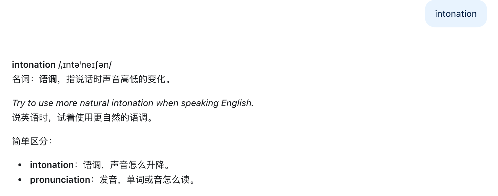
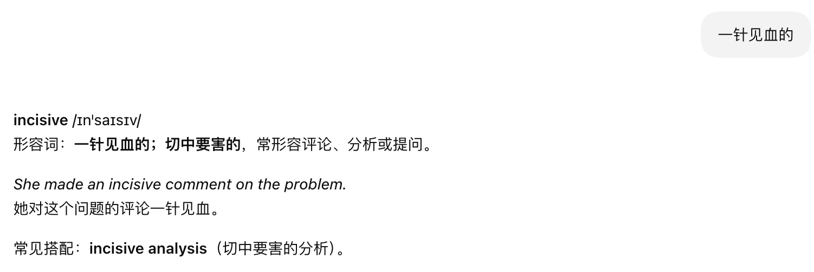
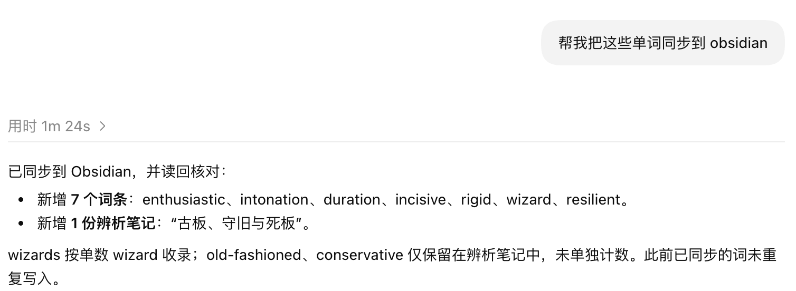
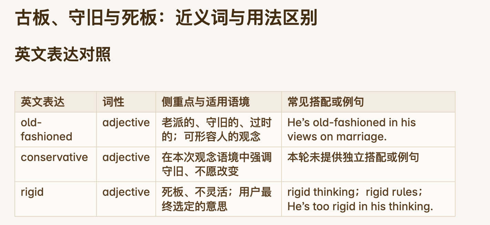
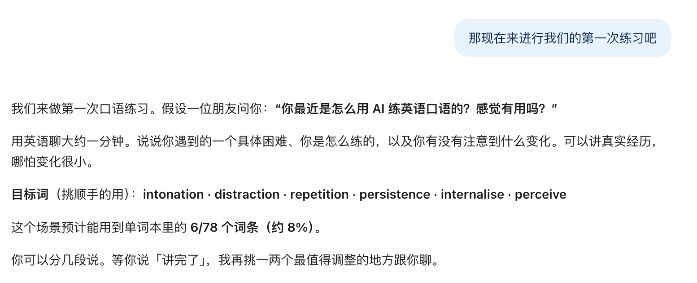
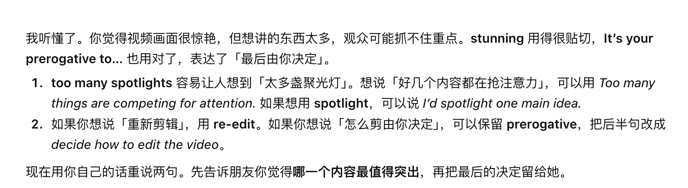
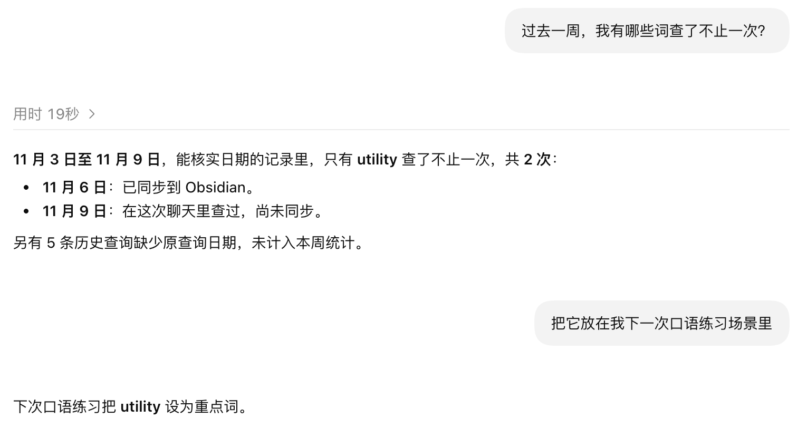

# Rue English Wordsnote

## 解决「认识≠会用」的问题

你是不是也有过这种感觉？阅读英文资料时，一个词出现，你马上就知道是什么意思。等到自己想表达同样的意思，那个词明明就在嘴边，却怎么也想不起来。

这就是**被动词汇**和**主动词汇**的区别。看到 *reluctant*，你知道它是「不情愿」。但在聊自己为什么不愿意当众说英语时，你能不能想起这个词，并说出 *I’m reluctant to speak English in public*？二语词汇研究发现，学习者能认出的词通常比能主动用出的词多，差距会随词频和测试方式变化。[相关研究](https://www.cambridge.org/core/journals/studies-in-second-language-acquisition/article/abs/receptive-and-productive-vocabulary-sizes-of-l2-learners/603A8FD24DBAA2874163DD36D8BAACA3)

背单词可以帮助我们积累被动词汇，但是却很少能帮助我们训练主动词汇。

这个 Skill 的目的，是围绕使用者，打造一个定制单词本，帮助使用者把查过但不常用的被动词汇，通过「记录-练习-反馈」逐步转化为能够自然使用的主动词汇。

## 复制口令，让 Agent 帮你安装

把下面这段发给支持 Skill 和本地文件操作的 Agent。安装时，Agent 会询问你的 Obsidian 单词本位置，并按应用要求处理文件权限。

```text
请帮我安装这个英语单词本 Skill：
https://github.com/rueislearning/rue-english-wordsnote

先读取仓库里的 INSTALL.md，检查当前 Agent 是否支持安装并完成安装。
然后询问我的 Obsidian 笔记库位置，配置单词本目录，实际写入并读回一份连接测试笔记。
完成后给我 README 里的启动指令，告诉我怎么开始查词和同步。
```

## 安装后，复制这段开始使用

在已安装 Skill、可以访问单词本的聊天里发送下面这段。手机使用时先选中保存词库的电脑。

```text
使用 $rue-english-wordsnote，开启我的英语单词本。

接下来，我直接发送英文词或中文词语时，请解释或翻译，并在当前聊天里暂存。
我说“同步到单词本”时，再保存到已配置的 Obsidian 目录。

我说“开始练习”时，请从单词本里挑几个词，生成一个自然场景，目标词只展示英文。
等我说“讲完了”，再给反馈，并让我用自己的话重说。

现在请读取已有配置，告诉我单词本是否已配置，以及我可以怎么开始。
如果还没有配置，请问我单词本目录。
```

## 打开以后怎么用

在 Codex 里调用 `$rue-english-wordsnote` 就能开始。第一次使用可以先看[安装与首次配置](#安装与首次配置)。

### 1. 英汉互译，直接发词

阅读时看到不认识的英文，直接发单词就行，比如 `intonation`。

| 截图 1 · 英译中 · 直接发送 intonation |
| :--- |
|  |

表达时想不起英语怎么说，也可以只发中文词或短语，AI 会先给解释和例句。

| 截图 2 · 中译英 · 直接发送「一针见血的」 |
| :--- |
|  |

你说「同步到单词本」后，词条才会按词性保存到 Obsidian。

| 截图 3 · 手动同步 · 查看写入结果 |
| :--- |
|  |

### 2. 汉译英拿不准语境时，AI 帮你区分近义词的用法

比如你直接发「古板的守旧的」，AI 会区分 *old-fashioned*（观念老派）、*conservative*（在这里指守旧、不愿改变）和 *rigid*（死板、不灵活），再问你更想表达哪一种。

| 截图 4 · 选词 · 比较「古板／守旧」的几种说法 |
| :--- |
|  |

你可以把选中的表达单独收为词条。说「同步到单词本」后，实际讨论过的近义表达会一起保存到 Obsidian 的「近义词」文件夹，方便下次遇到类似语境时再比较。

比如，最后选了 *rigid*，它会单独保存为词条。另外两种说法会留在同一份辨析笔记里。

| 截图 5 · Obsidian · 近义词辨析笔记 |
| :--- |
|  |

### 3. 根据单词本生成口语练习场景

你可以说「**给我一个场景，我们来练一下单词本里的单词。**」AI 会给你场景、表达任务和英文目标词，并告诉你这个场景预计能用到单词本里的多少词条。

比如，你可以练习用英语给朋友的短视频提剪辑建议。

| 截图 6 · 口语练习 · 场景、目标词和预计覆盖 |
| :--- |
|  |

你可以分几段说。等你说「**讲完了**」，AI 再挑一两个地方点评，然后请你用自己的话重说。

| 截图 7 · 练习反馈 · 说完后再点评 |
| :--- |
|  |

平时读到或听到一个好用的词，也可以顺手用它造一两个短句，或者用简单英语复述刚听懂的内容。影子跟读、练常用场景的小脚本、和语伴聊几句，也都可以搭配着练。

### 4. 看看哪些词反复查过

你可以问「过去一周，我有哪些词查了不止一次？」AI 会按原查询日期统计，把重复查过的词按次数列出来。如果这段时间查过的词都只问了一次，它会直接告诉你。

反复查到的词可以优先放进下一次练习。比如，下次直接说「用我这周查得最多的几个词，给我一个能自然用上它们的场景。」

| 截图 8 · 复习 · 把反复查询的词用进下次练习 |
| :--- |
|  |

## 安装与首次配置

同步与历史查询需要你的 AI 工具能访问 Obsidian 笔记库。

1. 在 GitHub 仓库页面选择 **Code → Download ZIP** 并解压。
2. 把包含 `SKILL.md` 的目录命名为 `rue-english-wordsnote`。Codex 用户将它放入自己电脑的 `~/.codex/skills/`；其他 agent 使用其支持的技能位置，不能仅凭复制文件就视为兼容。
3. 把 [config.example.json](config.example.json) 复制为同目录下的 `config.local.json`，将 `notebook_path` 改成自己 Obsidian 笔记库内单词本目录的绝对路径。个人配置不要上传 GitHub。
4. 在新聊天中调用 `$rue-english-wordsnote`，让 AI 实际创建并读回一份连接测试笔记。宿主要求文件授权时按提示完成。
5. 用 [试用案例](examples/try-it.md) 检查先解释后手动同步、重复同步去重、词性目录、只读频率和整句二次确认。连接测试与同步都要实际读回，不能只看回复。

不会编辑配置时，也可以在第一次调用时直接告诉 AI 单词本的真实目录。原有笔记应保留，建议为本技能使用独立目录。

## 同步与示例

结束聊天前，想保留查词或练习记录时说「同步到单词本」。待同步内容留在当前聊天，换聊天或历史截断后可能找不回来。

如果词是在普通 ChatGPT 里查的，可以在连接电脑的 Codex 聊天里引用那段旧对话，再说「用 `$rue-english-wordsnote` 同步这段对话里我实际查过的词」。AI 会按原查询记录补录，并告诉你哪些已经存过、哪些还需要核对。如果旧对话打不开，可以粘贴原始问答。能核实来源身份的查询才计入查询次数。[补录旧对话说明](references/connection.md#补录指定的旧对话)

同步后可在 Obsidian 的「词条」「近义词」和「练习」里查看笔记。想看完整 Markdown，可以打开[词条示例](examples/demo/shorten-entry.md)、[辨析示例](examples/demo/shorten-comparison.md)和[练习记录示例](examples/demo/shorten-practice.md)。

## 手机使用

1. 在手机 ChatGPT 的 **Codex／连接计算机** 里选保存 Obsidian 笔记库的电脑。电脑需在线，桌面应用保持运行。
2. 在这个聊天里调用 `$rue-english-wordsnote`，直接发一个想记的词。
3. 说「同步到单词本」，在 Obsidian 打开刚保存的词条。遇到文件授权提示时按应用指引处理。

普通 ChatGPT 聊天可以先查词。同步和历史统计需要当前会话能够访问电脑上的笔记库。[首次配对与排查](references/connection.md#手机端连接计算机)

## 分享

分享包包含技能规则、空白模板、配置示例、试用案例、本页展示的截图和说明。个人配置、完整词库、内部开发文档及配对信息均排除。分享时请单独打包这些公开文件。

其他 agent 需要支持加载这些规则，并具备对自己的词库读写的能力。不能访问文件时，技能不会假装已经保存。

这是基于记录与实际练习的辅助工具。询问次数不等于遗忘次数，场景覆盖率不等于英语掌握率。

## 验证范围与当前限制

| 项目 | 状态 |
| --- | --- |
| skill 格式、模板与文件链接 | 已检查 |
| 旧版整句确认、同义项计数、不同义项分开、场景与点评规则 | 已进行隔离的代理演练 |
| 2026-11-05 手动同步版 | 13 轮隔离演练覆盖查词、手动同步、再同步去重、词性目录和只读周频率 |
| 近义词辨析组 | 10轮隔离重放验证：手动同步、同组合并、保留手工补充、仅组同步及备选不虚增词频；未做手机现场测试 |
| 作者的 Mac + Obsidian + 手机连接计算机 | 2026-11-09 已实测查一个词、手动同步并从 Mac 读回。当前版重复查询、近义词同步和旧对话补录待手机实测 |
| 其他 agent、其他设备和系统 | 尚未实测，需按试用案例验证 |
| 真正断线后的恢复、多客户端同时写入、语音模式工具支持 | 尚未实测 |

目前按单人顺序使用设计，没有数据库事务锁。不提供后台监听、持久待同步队列、定时提醒、云端词库或平台间自动同步；电脑休眠、离线或宿主无权限时无法完成同步。已打开的聊天可能还保留旧规则，更新后建议新开聊天并明确调用技能。

## 反馈问题

可在 GitHub Issues 中说明使用的 AI 工具、系统、操作步骤、预期结果和实际结果。示例请用虚构词汇；不要上传个人词库、真实聊天、完整个人路径、密钥或配对码。

## 许可证

本项目采用 [MIT License](LICENSE)。分享或修改时请保留原版权声明及许可证。
